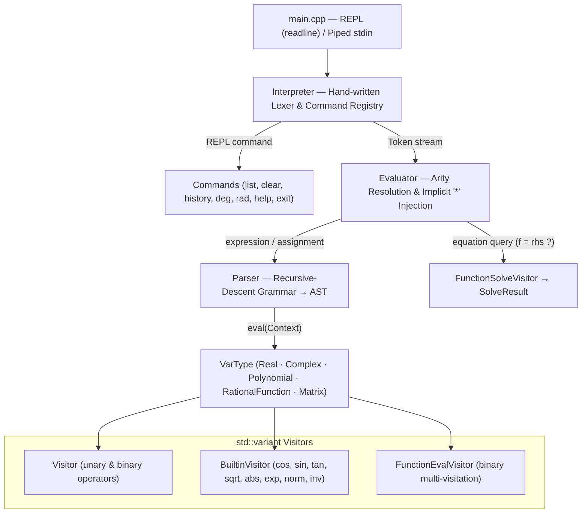

# computorv2


A **hand-built mathematical interpreter and Computer Algebra System (CAS)** written in C++20 — no Boost, no parser generator, no external math or symbolic algebra libraries. The entire pipeline from character-level lexing to algebraic simplification, matrix calculus, and equation solving is implemented from scratch.

---

## 📌 Project Context

Originally built as the **42 School** `computorv2` project (post-common-core), this interpreter goes beyond the base specification to include rational functions with polynomial GCD normalization, 1D vector operations, matrix evaluation of polynomials and rational functions, complex trigonometry, and an automated sanitizer-verified test suite.

**Key capabilities:**
- **First-class type tower:** `Real`, `Complex`, `Polynomial`, `RationalFunction`, `Matrix<Real>`, and `Matrix<Complex>` (plus 1D row/column vector operations).
- **Symbolic & algebraic engine:** undefined identifiers automatically act as formal polynomial indeterminates (preserving custom variable names like `y`, `t`, `z`), with implicit multiplication (`3x`, `2i`, `2(x + 1)`), function composition (`f(g(x))`), and PGCD-normalized rational fractions.
- **Equation solver:** solves polynomial and rational equations up to degree 2 with discriminant analysis, complex roots, and domain / excluded-pole reporting.
- **Zero external math/parsing dependencies:** only links GNU `readline` for interactive REPL line editing and history (automatically falls back to `std::getline` on piped stdin).

---

## 🏗️ Architecture & Pipeline



### Component Summary

| Module | File(s) | Responsibility |
|---|---|---|
| **Lexer & REPL** | `main.cpp`, `Interpreter.hpp`, `Interpreter.cpp`, `Commands.cpp` | Single-pass character scanner (no regex), case-insensitive tokenization, session `Context` (variables, constants `pi`/`e`/`sqrt2`/`i`, angle mode), REPL commands (`list`, `history`, `clear`, `deg`, `rad`, `help`, `exit`) |
| **Token** | `Token.hpp` | Typed token & operator enums with zero-allocation `toString()` formatting for error reporting |
| **Evaluator** | `Evaluator.hpp`, `Evaluator.cpp`, `EvaluatorNormalize.cpp` | Token normalization (unary/binary arity, implicit `*`), LHS/RHS dispatch, scoped parameter shadowing on function assignment, equation resolution |
| **Parser & AST** | `Parser.hpp`, `Parser.cpp`, `ParserPrimary.cpp`, `TokenStream.hpp`, `TokenStream.cpp`, `Nodes.hpp`, `Nodes.cpp` | Classic recursive-descent parser producing a typed `std::unique_ptr<ASTNode>` tree; supports 1D `[a, b]` vectors and 2D `[[a, b]; [c, d]]` matrices |
| **Visitors** | `Visitor.hpp`, `BuiltinVisitor.hpp`, `FunctionVisitor.hpp` | Exhaustive `std::visit` dispatch for operators, built-in math functions, multi-visitation function application (`FunctionEvalVisitor`), and equation solving (`FunctionSolveVisitor` → `SolveResult`) |
| **Real** | `Real.hpp`, `Real.cpp` | `double` wrapper with custom Newton-Raphson `sqrt`, binary exponentiation `pow`, Taylor-series `exp`/`sin`/`cos`/`arctan`, and continued-fraction pretty-printer ($\pi$ multiples, $\sqrt{n}$, reduced $p/q$, exact decimals) |
| **Complex** | `Complex.hpp`, `Complex.cpp` | Complex field arithmetic, exact integer binary exponentiation, principal square root, and Euler-formula complex trigonometry (`cos`, `sin`, `tan` via `exp(iz)`) |
| **Polynomial** | `Polynomial.hpp` | Real-coefficient polynomial ring with variable-name tracking (`mergeVar`), Euclidean division & polynomial `PGCD`, composition `eval(Polynomial)`, matrix polynomial evaluation `eval(Matrix<K>)`, and degree 0/1/2 solver (`Polynomial::Result`) |
| **RationalFunction** | `RationalFunction.hpp` | Fraction field $\mathbb{R}(X)$ built over `Polynomial`; automatic `PGCD` reduction and monic denominator normalization, full `+`/`-`/`*`/`/`/`^`, composition, matrix evaluation $P(A)Q(A)^{-1}$, and rational solver with pole/domain reporting (`RationalFunction::Result`) |
| **Matrix\<K\>** | `Matrix.hpp` | C++20 `real_complex`-constrained generic matrix & vector class: Gauss-Jordan inversion, binary-exponentiation matrix power, Frobenius norm, Hadamard `*`, matrix multiplication `**`, vector dot product, and matrix-vector multiplication |
| **Test Suite** | `tests/run_tests.py` | 61 end-to-end test suites verifying outputs, error handling, edge cases, and memory safety under ASan/UBSan/LSan |

---

## 🧠 Engineering Highlights

### 1. Hand-written lexer + pre-parse normalization pass
`Lexer::tokenize()` scans input in a single character-by-character pass without `<regex>`. Before the recursive-descent parser runs, `Evaluator::normalize()` resolves operator arity (unary vs. binary `+/-`) and injects implicit `*` tokens between adjacent expression boundaries (`3x`, `2i`, `2(x + 1)`, `(a + 1)(a - 1)`) while preserving function calls (`f(x)`).

### 2. Static-safety `std::variant` multi-visitation
All runtime values live in a single closed sum type:
```cpp
using VarType = std::variant<Real, Complex, Polynomial, RationalFunction, Matrix<Real>, Matrix<Complex>>;
```
Instead of virtual double-dispatch or runtime tag enums, operations use stateless `std::visit` overload sets—including **binary multi-visitation** in `Visitor` and `FunctionEvalVisitor` (dispatching on `(function, argument)` pairs in one call) and a dedicated `SolveResult = std::variant<Polynomial::Result, RationalFunction::Result>` to keep computation strictly decoupled from stream formatting.

### 3. Polynomial GCD & Rational Function field ($\mathbb{R}(X)$)
Dividing two polynomials constructs a `RationalFunction` that automatically computes `PGCD(num, denom)` via polynomial Euclidean division, divides out common factors, and normalizes the denominator to be monic. Beyond scalar and symbolic composition, rational functions can also be evaluated on square matrices as $f(A) = P(A) \cdot Q(A)^{-1}$ using Gauss-Jordan inversion.

### 4. Custom math primitives & readable symbolic output
Trigonometry, exponentials, square roots, and integer powers are implemented directly in `Real` and `Complex` (Taylor series, Newton-Raphson, Euler identities, and binary exponentiation by squaring). `Real`'s stream formatter recognizes exact integers, clean terminating decimals, $\pi$ fractions, small square roots ($\sqrt{n}$), and continued-fraction rationals ($p/q$).

---

## 🚀 Quick Start

**Requirements:** C++20 compiler (`clang++` or `g++`), GNU `readline` (plus `python3` to run tests).

### Build with Make
```bash
make          # builds ./computorv2 (-Wall -Wextra -Werror -std=c++20)
make clean    # removes object files
make fclean   # removes objects and binary
make re       # full rebuild
```

### Build with CMake (Debug with ASan + UBSan + LSan)
```bash
cmake -S . -B build -DCMAKE_BUILD_TYPE=Debug
cmake --build build
```

### Run & Test
```bash
./computorv2                              # interactive REPL
python3 tests/run_tests.py ./computorv2   # run 61 end-to-end test suites
python3 tests/run_tests.py                # run against ./build/computorv2 (sanitizers enabled)
```

---

## 💻 Showcase

### Polynomial & complex-root solving
```text
> f(x) = x^2 + 1
x^2 + 1
> f(x) = 0 ?
Polynomial degree: 2
Discriminant is -4
Strictly negative, the two solutions are:
-i
i
```

### Rational functions — PGCD reduction & domain-aware solving
```text
> g(x) = (x^2 - 3*x + 2) / (x^2 - 4*x + 3)
(x - 2)/(x - 3)
> f(x) = (x^2 - 1) / (x - 2)
(x^2 - 1)/(x - 2)
> f(x) = 0 ?
Reduced form: (x^2 - 1)/(x - 2) = 0
Excluded values (denominator = 0): 2
Solving numerator: x^2 - 1 = 0
Polynomial degree: 2
Discriminant is 4
Strictly positive, the two solutions are:
-1
1
```

### Matrices, vectors & matrix evaluation of functions
```text
> A = [[2, 0]; [0, 3]]
[[2, 0]; [0, 3]]
> f(x) = (x + 1) / (x - 1)
(x + 1)/(x - 1)
> f(A)
[[3, 0]; [0, 2]]
> [1, 2, 3] ** [4, 5, 6]
32
> [[1, 2]; [3, 4]] ** [5, 6]
[17, 39]
> inv([[1, i]; [0, 1]])
[[1, -i]; [0, 1]]
```

### Function composition & implicit multiplication
```text
> f(y) = 3y^2 + 2y
3y^2 + 2y
> g(y) = y + 1
y + 1
> f(g(y)) ?
3y^2 + 8y + 5
```
